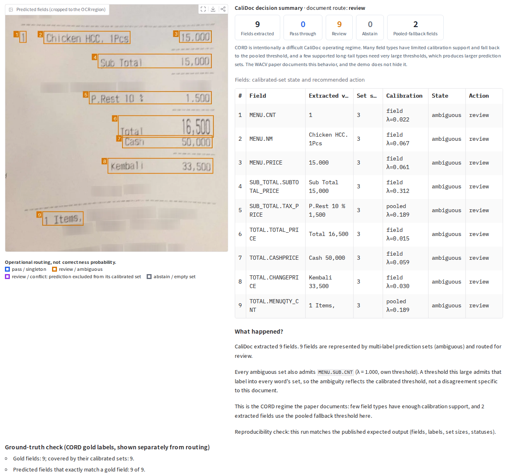
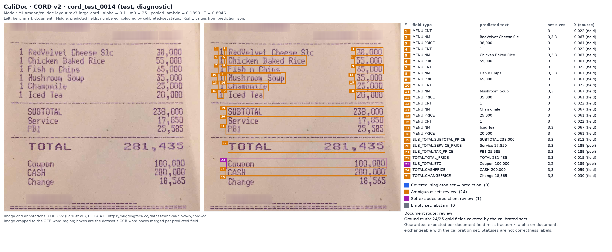

# CaliDoc

**Calibrated field-level risk and annotation auditing for document information extraction.**
Mohammed Hamdan and Mohamed Cheriet, Synchromedia Laboratory, École de technologie supérieure (ÉTS), Montréal.

[](https://wacv.thecvf.com/)
[](#citation)
[](https://github.com/MHHamdan/CaliDoc/releases/download/wacv2027-camera-ready/CaliDoc_WACV2027_Supplementary.pdf)
[](https://huggingface.co/collections/MHamdan/calidoc-wacv-2027-6ad41a62c6a81846dfeb44b4)
[](https://colab.research.google.com/github/MHHamdan/CaliDoc/blob/main/notebooks/CaliDoc_WACV2027_Demo.ipynb)
[](demo/gradio)
[](#license)
[](#license)


Accepted at **WACV 2027** (IEEE/CVF Winter Conference on Applications of Computer Vision,
Evaluations and Datasets Track).

> Token-level reliability is not complete-field reliability.
> CaliDoc calibrates and audits the object downstream systems actually consume:
> the complete field.


## What CaliDoc Does

1. **Complete-field reliability.** A field is scored by its worst word,
   *S(s) = max<sub>i∈s</sub> (1 − p(g<sub>i</sub> | x<sub>i</sub>))*. A field is fully
   covered at threshold λ exactly when *S(s) ≤ λ*. The extractor is not retrained.
2. **Conformal field-miss risk (SpanCRC).** With the document as the exchangeable unit,
   conformal risk control picks thresholds so that the **expected per-document fraction of
   missed gold fields is at most α**. Field types with enough calibration support get
   their own threshold; the rest fall back to a pooled one.
3. **Annotation auditing.** At the same calibrated threshold, a boundary-escape test asks
   whether escapes pile up at field edges, which is where alignment and BIO-labelling
   errors live. The test uses an explicit randomization null, Holm control and a
   document-blocked bootstrap. On SROIE it flags `ADDRESS` and `COMPANY`.

## Try CaliDoc in 60 Seconds

### Option 1: Google Colab (recommended)

[](https://colab.research.google.com/github/MHHamdan/CaliDoc/blob/main/notebooks/CaliDoc_WACV2027_Demo.ipynb)

The notebook installs CaliDoc from this repository and runs the released CORD model on
two real test receipts. It can also launch the interactive app with a temporary public
link. It needs no account, token or upload.

### Option 2: Local Gradio app (for developers)

```bash
git clone https://github.com/MHHamdan/CaliDoc.git && cd CaliDoc
pip install -e ".[demo]"
python demo/gradio/app.py        # http://127.0.0.1:7860
```

The **Try a Real Example** tab runs without any input. **Upload Your Own** takes an image
plus OCR words and boxes, with any of the four released models. See
[`demo/gradio/README.md`](demo/gradio/README.md).

### Option 3: Python API / command line

```bash
git clone https://github.com/MHHamdan/CaliDoc.git && cd CaliDoc
pip install .
python -m calidoc.predict \
    --model MHamdan/calidoc-layoutlmv3-large-cord \
    --image assets/examples/cord/cord_test_0042/document.png \
    --ocr   assets/examples/cord/cord_test_0042/ocr.json \
    --out   prediction.json
```

This downloads the released CORD checkpoint (1.4 GB) and runs it on a CORD v2 test receipt
shipped in this repository. It writes one entry per extracted field:

```json
{
  "type": "TOTAL.TOTAL_PRICE",
  "text": "Total 16,500",
  "labels": ["B-TOTAL.TOTAL_PRICE", "I-TOTAL.TOTAL_PRICE"],
  "set_sizes": [3, 3],
  "other_labels_in_set": ["B-MENU.SUB.CNT", "I-MENU.SUB.CNT"],
  "threshold": 0.0149,
  "threshold_source": "field",
  "status": "ambiguous_review"
}
```

plus a document `summary.route` (`accept` / `review`) and the calibration metadata.
**OCR is an input, not part of CaliDoc.** Bring your own words and boxes in the format of
[`ocr.json`](assets/examples/cord/cord_test_0042/ocr.json) (`box_format` `pixel` or
`normalized_1000`).

## CaliDoc in Action

These are real CORD v2 test receipts (CC BY 4.0, Park et al. 2019), run through the
released checkpoint. They were selected by a fixed rule (median and 90th-percentile word
count over documents not used for calibration), not by prediction quality. Every value
shown is machine-generated by [`tools/showcase_examples.py`](tools/showcase_examples.py)
and the demo app.

**Representative receipt: `cord_test_0042`** ·
[prediction.json](assets/examples/cord/cord_test_0042/prediction.json) ·
[inputs on the Hub](https://huggingface.co/datasets/MHamdan/calidoc-demo-examples/tree/main/cord_test_0042)



| fields extracted | pass | review | abstain | pooled-fallback fields | correct vs. CORD gold |
|---|---|---|---|---|---|
| 9 | 0 | 9 | 0 | 2 | 9 / 9 |

All 9 extractions are correct, and all 9 are still routed for review. On CORD the
supported field type `MENU.SUB.CNT` has calibrated threshold λ = 1.0, so its label enters
every word's prediction set. The paper documents this CORD cost, and the demo shows it
rather than hiding it.

### Why review routing matters

**Review-routing case: `cord_test_0014`** ·
[prediction.json](assets/examples/cord/cord_test_0014/prediction.json)



| fields extracted | pass | review (ambiguous) | review (conflict) | abstain | correct vs. CORD gold |
|---|---|---|---|---|---|
| 25 | 0 | 24 | 1 | 0 | 24 / 25 |

Field 23, *Coupon 100,000*, is the one wrong extraction on the page: gold is
`TOTAL.TOTAL_ETC`, predicted `SUB_TOTAL.ETC`. CaliDoc does not present it as a confident
final field. Its worst-word score is 0.80, against the pooled fallback threshold of 0.189
that its rare field type inherits, so its calibrated set excludes the prediction. It is
the only field in state `conflict`. 24 of the 25 gold fields are covered by their
calibrated sets.

### Other datasets

FUNSD, WildReceipt and SROIE are not cleared for redistribution, so only structural output
is shown (field types, positions, set sizes, statuses; no text or images):

| Dataset | Document | Role | Fields | Status counts | Route | Output |
|---|---|---|---|---|---|---|
| SROIE | `sroie_test_X51005568889` | representative | 4 | 4 covered | accept | [prediction.json](assets/examples/sroie/sroie_test_X51005568889/prediction.json) |
| FUNSD | `funsd_test_87093315_87093318` | representative | 100 | 15 covered, 85 ambiguous | review | [prediction.json](assets/examples/funsd/funsd_test_87093315_87093318/prediction.json) |
| WildReceipt | `wildreceipt_test_32abb05d…` | representative | 17 | 16 covered, 1 empty set | review | [prediction.json](assets/examples/wildreceipt/wildreceipt_test_32abb05dc239b237b39b094a784e23cd7f251dbb/prediction.json) |

These rows illustrate the documented per-dataset behaviour:

- **SROIE:** near-singleton sets on four short-schema fields.
- **FUNSD:** long form fields and a small calibration set give large thresholds, so most
  fields are flagged.
- **WildReceipt:** close to singleton output, with one word left without any label clearing
  its threshold, which triggers an abstention.

Selection rules, document IDs, attributions and checks are in
[`docs/release/SHOWCASE_EXAMPLE_AUDIT.md`](docs/release/SHOWCASE_EXAMPLE_AUDIT.md).

## Models

One LayoutLMv3-Large checkpoint per benchmark. These are dataset-specific: **there is no
universal CaliDoc model.** Each repository holds the paper's predeclared **seed-42**
checkpoint (the one every ablation, SpanCRC and audit result uses) and the calibration
files fitted for it. All are in the Hugging Face collection
[CaliDoc — WACV 2027](https://huggingface.co/collections/MHamdan/calidoc-wacv-2027-6ad41a62c6a81846dfeb44b4).

| Dataset | Backbone | Hugging Face | Paper F1 (3 seeds) | Released checkpoint F1 | Calibration (α = 0.10, m0 = 25) |
|---|---|---|---|---|---|
| SROIE (case study) | LayoutLMv3-Large | [calidoc-layoutlmv3-large-sroie](https://huggingface.co/MHamdan/calidoc-layoutlmv3-large-sroie) | 94.54 ± 0.33 | 94.92 | 4 / 4 field types own λ |
| CORD | LayoutLMv3-Large | [calidoc-layoutlmv3-large-cord](https://huggingface.co/MHamdan/calidoc-layoutlmv3-large-cord) | 95.15 ± 1.23 | 93.44 | 9 / 29 own λ, rest pooled |
| FUNSD | LayoutLMv3-Large | [calidoc-layoutlmv3-large-funsd](https://huggingface.co/MHamdan/calidoc-layoutlmv3-large-funsd) | 82.39 ± 0.65 | 82.70 | 3 / 3 own λ |
| WildReceipt | LayoutLMv3-Large | [calidoc-layoutlmv3-large-wildreceipt](https://huggingface.co/MHamdan/calidoc-layoutlmv3-large-wildreceipt) | 94.38 ± 0.27 | 94.04 | 22 / 24 own λ |

- **Paper F1** is entity-level test F1, mean ± s.d. over training seeds 42/123/456.
- **Released checkpoint F1** is the seed-42 model alone, on the full test split. Do not
  read the three-seed mean as the score of the released checkpoint. On CORD, seed 42 is
  the low tail (93.44 / 95.70 / 96.29). It is released because it is the predeclared
  canonical checkpoint, not because it scores best.
- **SROIE** is trained on the upstream pre-tagged labels, which the audit shows to be
  defective, and is released as the case-study checkpoint.

## Why Complete Fields Matter

On SROIE, a LayoutLMv3-Large tagger calibrated with a single token-marginal threshold
reaches **89.8% token coverage at a 90% target**, which looks nominal, while **none of the
420 gold field spans is fully covered**. The threshold is sized for the background class,
which holds 84% of tokens. Every field the downstream system consumes is missed on every
document (realized field-miss risk 1.000).

The paper's numbers for the seed-42 checkpoints (90% target, mean over three calibration
splits):

| | token-marginal threshold | field-conditional SpanCRC |
|---|---|---|
| SROIE full-span coverage | 0.000 | 0.909 |
| SROIE field-miss risk (bounded by α = 0.10 in expectation) | 1.000 | 0.091 |
| SROIE average set size | 0.90 | 0.99 |
| WildReceipt full-span coverage / set size | 0.918 / 0.93 | 0.913 / 0.93 |
| FUNSD full-span coverage / set size | 0.950 / 1.71 | 0.944 / 2.10 |
| CORD full-span coverage / set size | 0.872 / 0.90 | 0.886 / 2.92 |

CaliDoc helps in proportion to how badly the token threshold fails. It is nearly free
where token calibration already works (WildReceipt), and costly where most field types lack
calibration support (CORD).

## Where CaliDoc Fits in a Real Workflow

```
Document
   ↓
OCR (words + boxes)
   ↓
KIE model (LayoutLMv3 token classification)
   ↓
CaliDoc calibrated field sets
   ├── covered (singleton set = prediction)  → downstream system
   ├── ambiguous set                         → validation / review
   ├── set excludes prediction, or empty     → abstain / review
   └── boundary escapes concentrated at edges, across a corpus → dataset annotation audit
```

These are workflow patterns, not certified deployments. The released checkpoints are
benchmark models: they cover the four benchmark document types and nothing else. Any
other domain needs its own extractor and its own calibration set.

### Receipt and expense processing
Merchant, date, address and total (SROIE's schema; CORD and WildReceipt for richer
receipts). CaliDoc tells you whether a *complete* field, not just most of its words, is
reliably represented before it enters an accounting system. A total with an empty or
conflicting set goes to a person, and a covered total goes through.

### Accounts payable and invoice intake
The same pattern applies to invoice identifiers, vendor names, dates and amounts. None of
the released models is trained on invoices. Using CaliDoc for invoices means fine-tuning
an extractor on invoices and calibrating it on held-out invoices from the same intake
stream. The method then gives the same document-level field-miss bound.

### Administrative form processing
FUNSD-style forms (headers, questions, answers): structured extraction with document
routing and human verification. Long answers make the max-word score conservative, so
expect larger sets and more review than on receipts.

### Dataset quality assurance
Run the boundary-escape test over a labelled corpus to find field types whose escapes
concentrate at span edges, a fingerprint of alignment and BIO errors. This is a
**corpus-level** diagnostic for prioritising annotation review, not a per-document error
oracle. It cannot see fields of two words or fewer.

### Human-in-the-loop document AI
CaliDoc pays off when an uncertain complete field costs more than routing it to review.
It decides *what* a reviewer should look at, and it does not remove the reviewer from
consequential decisions.

## Quick Start

### 1. Install
```bash
git clone https://github.com/MHHamdan/CaliDoc.git && cd CaliDoc
pip install .                 # inference only: torch, transformers, huggingface-hub, pillow
pip install ".[research]"     # optional: full training and analysis stack (requirements.txt)
```

### 2. Load a model
```python
from calidoc.inference import CaliDocPredictor
predictor = CaliDocPredictor.from_pretrained("MHamdan/calidoc-layoutlmv3-large-cord")
```
The weights are a standard `LayoutLMv3ForTokenClassification`
(`AutoModelForTokenClassification.from_pretrained(...)` works on its own). The predictor
adds the temperature and SpanCRC thresholds from the repository's `calibration/` files.

### 3. Run document extraction
```python
import json
from PIL import Image
from calidoc.inference import normalize_boxes

image = Image.open("assets/examples/cord/cord_test_0042/document.png").convert("RGB")
ocr = json.load(open("assets/examples/cord/cord_test_0042/ocr.json"))
boxes = ocr["boxes"] if ocr["box_format"] == "normalized_1000" else normalize_boxes(ocr["boxes"], *image.size)
result = predictor.predict(image, ocr["words"], boxes)
```

### 4. Apply CaliDoc calibration
`predict` already applies it: probabilities are temperature-scaled, and word *i*'s set is
`{y : 1 − p(y|x_i) ≤ λ_type(y)}`. The raw pieces are available too:
```python
probs = predictor.word_probabilities(image, ocr["words"], boxes)   # [n_words, n_labels]
sets = predictor.calibrated_sets(probs)                           # boolean membership
print(result["calibration"]["pooled_lambda"], result["calibration"]["fallback_fields"])
```

### 5. Inspect and review uncertain fields
```python
for f in result["fields"]:
    if f["status"] != "covered":
        print(f["status"], f["type"], repr(f["text"]), "also admits:", f["other_labels_in_set"])
print("possible missed fields:", result["unassigned_field_candidates"])
print("route:", result["summary"]["route"])
```
Statuses are properties of calibrated prediction sets, not probabilities of correctness.
The guarantee is a bound on the *expected* per-document field-miss fraction, and it holds
for documents exchangeable with the calibration documents.

## Hugging Face

- Collection: [CaliDoc — WACV 2027](https://huggingface.co/collections/MHamdan/calidoc-wacv-2027-6ad41a62c6a81846dfeb44b4)
- Model cards: [SROIE](https://huggingface.co/MHamdan/calidoc-layoutlmv3-large-sroie) ·
  [CORD](https://huggingface.co/MHamdan/calidoc-layoutlmv3-large-cord) ·
  [FUNSD](https://huggingface.co/MHamdan/calidoc-layoutlmv3-large-funsd) ·
  [WildReceipt](https://huggingface.co/MHamdan/calidoc-layoutlmv3-large-wildreceipt)
- Demo examples: [MHamdan/calidoc-demo-examples](https://huggingface.co/datasets/MHamdan/calidoc-demo-examples),
  the two CORD v2 receipts with OCR, metadata and expected outputs, used by the app and the
  Colab notebook
- There is no hosted Space. Use the Colab notebook or the local app.

Each card documents the checkpoint, every threshold, the paper and released-checkpoint
metrics separately, and the limitations. Provenance (hashes, tensor equality, parity with
the paper's cached probabilities) is in
[`docs/release/HF_MODEL_ARTIFACT_AUDIT.md`](docs/release/HF_MODEL_ARTIFACT_AUDIT.md).

## Reproducing WACV 2027 Results

This path is separate from the quick start above. It retrains and recalibrates from the
dataset bundles and needs `pip install ".[research]"`, the datasets (see
[Dataset Licenses](#dataset-licenses-and-attribution)) and a GPU for training.

Training, probability caching and field-level calibration for one dataset:

```bash
python scripts/train.py training=cord_phase2 dataset=cord
python scripts/cache_probs.py --dataset cord
python scripts/span_crc.py --dataset cord
```

Every table and figure in the paper is computed post hoc on CPU, from the cached
temperature-scaled probabilities:

```bash
python scripts/span_crc.py --all
python scripts/multiplicity_analysis.py
python scripts/spancrc_sensitivity.py
python scripts/boundary_escape_power.py
python scripts/first_token_entity_cp.py
python scripts/emit_result_macros.py
```

Headline metrics average training seeds {42, 123, 456}. Ablations use seed 42. Seeds,
split definitions and determinism settings are recorded per run in the emitted result
JSON. The released checkpoints are rebuilt from the local research artifacts by
[`tools/export_hf_release.py`](tools/export_hf_release.py), which asserts tensor equality
and threshold equality with the paper's committed results.

### Repository layout
```
calidoc/              library: inference API, data, models, training
calidoc/inference.py  CaliDocPredictor: released checkpoint + SpanCRC thresholds
scripts/              experiment entry points, analysis, artifact emitters
tools/                release tooling: HF export, model cards, showcase examples
configs/              Hydra configs per dataset, model and training strategy
assets/               architecture figure, showcase examples, demo screenshots
demo/gradio/          interactive Gradio demo (example-first, upload your own)
notebooks/            Colab demo notebook
docs/release/         release audits (artifacts, licenses, examples, smoke test)
```

## Dataset Licenses and Attribution

| Dataset | Source | License | In this repository |
|---|---|---|---|
| CORD v2 | Park et al., *CORD: A Consolidated Receipt Dataset for Post-OCR Parsing*, 2019 · [naver-clova-ix/cord-v2](https://huggingface.co/datasets/naver-clova-ix/cord-v2) | CC BY 4.0 | two test receipts (image, OCR words/boxes, gold labels) under `assets/examples/cord/` and in [MHamdan/calidoc-demo-examples](https://huggingface.co/datasets/MHamdan/calidoc-demo-examples) |
| FUNSD | Jaume, Ekenel, Thiran, ICDAR-OST 2019 · [official site](https://guillaumejaume.github.io/FUNSD/) | FUNSD License (non-commercial research) | structural output only |
| WildReceipt | Sun et al., arXiv:2103.14470, 2021 · [MMOCR dataset zoo](https://mmocr.readthedocs.io/en/dev-1.x/user_guides/data_prepare/datasetzoo.html) | none stated by the authors | structural output only |
| SROIE | Huang et al., ICDAR 2019 · [RRC Task 3](https://rrc.cvc.uab.es/?ch=13) | not confirmed on the organizers' public pages | structural output only |

The full audit, with verbatim license text, is in
[`docs/release/DATASET_LICENSE_AUDIT.md`](docs/release/DATASET_LICENSE_AUDIT.md).

## Limitations

- **Dataset-specific checkpoints**, four English-script benchmarks, one backbone family.
  Calibration does not transfer to other domains, layouts or OCR engines.
- **OCR dependence.** The paper uses dataset-provided OCR, and no OCR engine ships with
  CaliDoc.
- **Max-score conservatism.** The worst word decides a field, so long fields need larger
  thresholds and larger sets.
- **Support-limited conditioning.** Field types with fewer than m0 = 25 calibration spans
  fall back to the pooled threshold and get no per-type guarantee. On CORD this applies to
  most types and inflates sets about 3.2×.
- **Short-span audit blind spot.** The boundary-escape test cannot see fields of two words
  or fewer, and was validated on one real defective corpus (SROIE) plus synthetic
  corruption.
- **Audit independence assumption.** The randomization null assumes independence across
  spans; this is stated rather than derived. Findings are claimed only when a
  document-blocked bootstrap agrees.
- **Expectation, not certainty.** A single document, or a single calibration split, can
  exceed α.
- **Not a replacement for human review** in consequential workflows.

## Citation

Accepted at WACV 2027 (Evaluations and Datasets Track). Proceedings metadata (pages, DOI)
will be added once published.

```bibtex
@inproceedings{hamdan2027calidoc,
  author    = {Hamdan, Mohammed and Cheriet, Mohamed},
  title     = {{CaliDoc}: Calibrated Field-Level Risk and Annotation Auditing for Document Information Extraction},
  booktitle = {Proceedings of the IEEE/CVF Winter Conference on Applications of Computer Vision (WACV)},
  year      = {2027},
  note      = {Accepted at WACV 2027 (Evaluations and Datasets Track)}
}
```

## License

- **Source code:** Apache-2.0.
- **Released model weights:** CC BY-NC-SA 4.0, inherited from
  [microsoft/layoutlmv3-large](https://huggingface.co/microsoft/layoutlmv3-large). Non-commercial use only.
- **Example images and annotations** under `assets/examples/cord/`: CORD v2, CC BY 4.0,
  © the CORD authors (Park et al., 2019).
